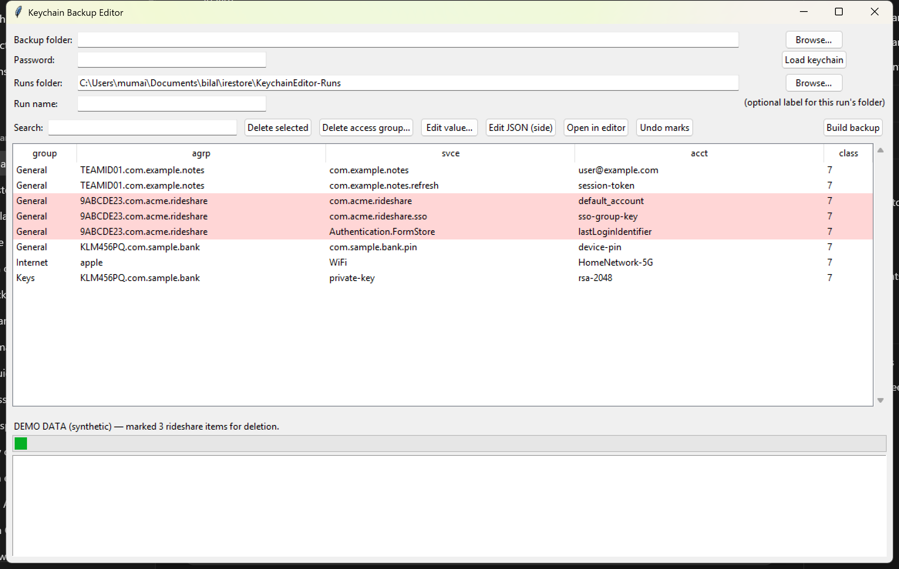
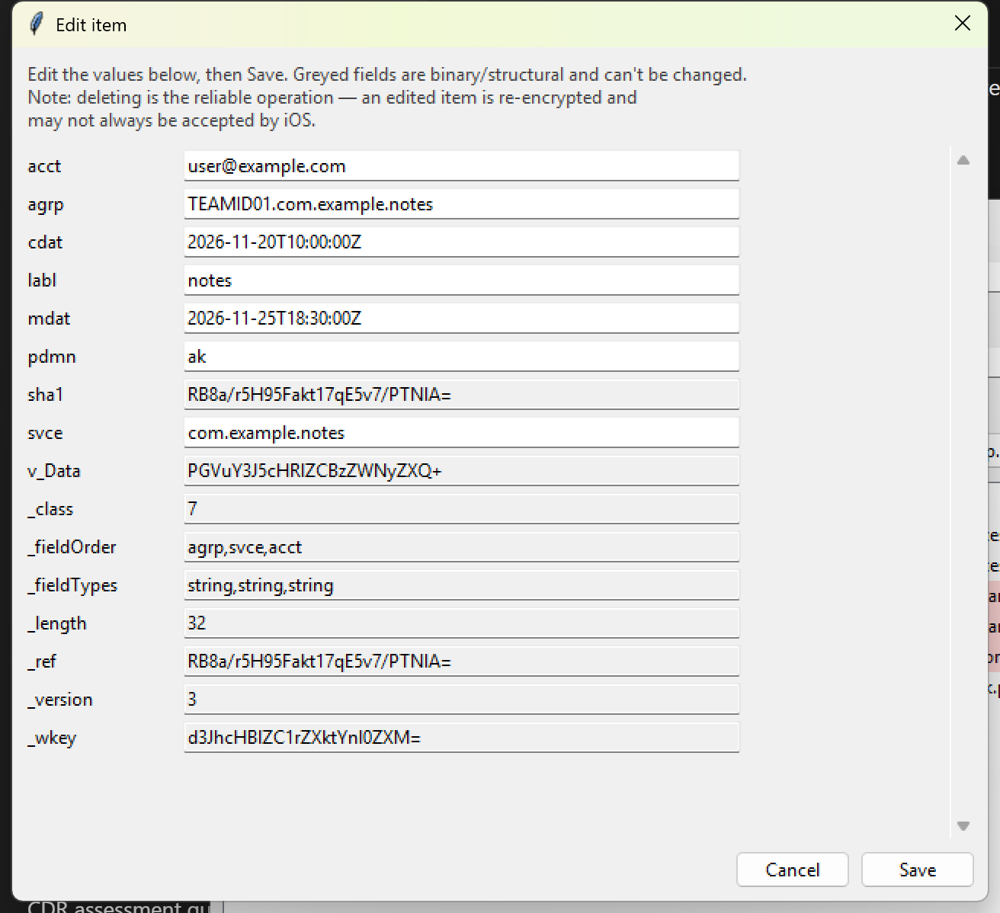

# Keychain Backup Editor

A small Windows desktop app for viewing and editing the **keychain** inside an
encrypted iTunes / Finder **iPhone backup**, then rebuilding a backup you can
restore. It is a friendly GUI on top of the command‑line
[`irestore`](https://github.com/dnicolson/irestore) tool, with fixes that make a
**modified** backup restore correctly.

Typical use: remove a single app's stored logins/tokens from a backup so that,
after restoring and reinstalling, the app starts **fresh** — without wiping the
whole device.

> ⚠️ **Read the [Warnings](#warnings) before you use this.** You are editing a
> backup of your own device. Mistakes can cost you data. Only use it on backups
> of devices **you own**.

---

## Features

- Open an encrypted backup and enter the **password once**.
- Browse every readable keychain item in a **searchable table**
  (access group / service / account).
- **Delete** items — selected rows, or **every item in an access group**
  (one click).
- **Edit** individual field values through a form, or edit the **raw JSON**
  directly — in a built-in side editor or your own external editor — and import
  it back (advanced; see warnings).
- Rebuilds a **restorable** backup, with the manifest kept consistent so iTunes
  accepts it.
- Every run is saved in its **own folder** with the dump, the edited dump, a
  change summary, and step‑by‑step restore instructions.
- No console windows pop up; a progress bar shows what it's doing.
- Ships as a single **self‑contained `.exe`** (no Python needed).

---

## Screenshots

> Shown with **synthetic demo data** — not a real keychain.



*Browsing the keychain. Rows highlighted red are marked for deletion (here, a
whole access group).*



*Editing one item's fields in a form. Binary/structural fields are greyed out so
they can't be corrupted.*

---

## Download & run

1. Grab `KeychainBackupEditor.exe` from the **Releases** page (or build it
   yourself — see [Building](#building-from-source)).
2. Put it in a **writable** folder (it creates run folders next to itself).
3. Double‑click it.

> Windows SmartScreen / antivirus may warn because the `.exe` is **unsigned**
> (a common false positive for PyInstaller apps). Choose **More info → Run
> anyway**, or build it yourself from source.

---

## How to use

1. **Backup folder** — Browse to the backup that contains `Manifest.db`
   (usually `C:\Users\<you>\Apple\MobileSync\Backup\<device-id>`).
2. **Password** — enter the backup's encryption password (asked once).
3. **Runs folder / Run name** — optional: where to keep runs, and a label for
   this one.
4. **Load keychain** — the table fills with all readable items.
5. **Search** to filter. Then either:
   - select rows and **Delete selected**, or
   - **Delete access group…** and type the app's access group
     (e.g. `5F83KRY2FH.com.ubercab.UberPartner`), or
   - double‑click a row to **edit a value**, or
   - **Edit JSON (side)** / **Open in editor** to edit the whole dump as raw
     JSON (delete items or change values, keep `_ref` intact) and import it back.
6. **Build backup** — creates a rebuilt backup plus a summary and restore
   instructions in the run folder.

### Restoring the rebuilt backup

The app writes the exact steps to `restore-instructions.txt`. In short:

1. Close iTunes / the Apple Devices app.
2. **Back up your original first:** in
   `C:\Users\<you>\Apple\MobileSync\Backup`
   (older iTunes: `…\AppData\Roaming\Apple Computer\MobileSync\Backup`),
   rename the `<device-id>` folder to `<device-id> - ORIGINAL`.
3. Copy the rebuilt backup into `MobileSync\Backup`, named **exactly**
   `<device-id>`.
4. In iTunes / Apple Devices, pick your device → **Restore Backup…** → restore.
5. Reinstall the app from the App Store.
6. To undo: delete the edited folder and rename `<device-id> - ORIGINAL` back to
   `<device-id>`.

---

## What each run saves

```
<Runs folder>/<timestamp>-<name>/
├── dump.json               # original keychain (readable items)
├── edited-dump.json        # after your deletes/edits
├── original-restore/       # original keychain plist
├── merged-restore/         # edited keychain plist
├── rebuilt-backup/         # the backup to restore
├── run-summary.txt / .json # what changed (group | service | account)
└── restore-instructions.txt
```

---

## Warnings

- **This is for backups of devices you own.** Do not use it to bypass security,
  access someone else's data, or defeat activation / anti‑theft protections.
- **Back up your original backup first.** Keep an untouched copy before you
  restore anything.
- **Deleting is reliable; editing is not.** Deleted items are simply removed.
  An **edited** item is re‑encrypted when the backup is rebuilt, and iOS is
  pickier about edited items — they may not always be accepted. For a clean
  "reset an app" job, **delete** its items.
- **Items the tool can't decrypt are preserved automatically.** They don't show
  in the table and are copied through untouched — you can't accidentally drop
  them.
- **Encrypted backups only** for keychain access. The backup must be encrypted
  (that's what lets the keychain be read) and you must know the password.
- **No warranty.** Restoring a modified backup is at your own risk. See the
  [licence](LICENSE).
- The `.exe` is **unsigned**; verify the source or build it yourself if that
  matters to you.

---

## How it works

The app drives `irestore` to: `dumpkeys` (read the keychain), `restore`
(decrypt the keychain file), then — after your edits — optionally `encryptkeys`
and finally `unrestore` (rebuild the backup). The password is passed once via an
`IRESTORE_PASSWORD` environment variable, and it merges your changes into the
original keychain so that items the tool can't decrypt are preserved.

This project also fixes a bug that made **modified** backups fail to restore —
see [`docs/irestore-patches.md`](docs/irestore-patches.md). In short: after a
delete, `irestore` left the keychain file's old `Size` in `Manifest.db`, so
iTunes read past the end of the now‑smaller file and reported
*"backup is corrupted."* The patched build writes the correct size (and digest),
and flushes the database before reading it back.

---

## Building from source

Requires Windows, Python 3.11+, and a built `irestore.exe` (the patched build)
next to the script.

```bat
pip install -r requirements.txt
build.bat
```

The result is `release\KeychainBackupEditor.exe`. To run without building:

```bat
python keychain_backup_editor.py
```

(`irestore.exe` must be in the same folder.)

---

## Credits

- **[irestore](https://github.com/dnicolson/irestore)** by **Dennis Nicolson** —
  the Go tool this builds on (the `restore` / `unrestore` / `dumpkeys` /
  `encryptkeys` commands).
- **[iphone‑dataprotection / ios](https://github.com/dunhamsteve/ios)** by
  **Steve Dunham** — the underlying iOS backup & keychain parsing code.
- Keychain Backup Editor GUI and the `irestore` restore fixes: **[umairsali07](https://github.com/umairsali07)**.

This project is **not** affiliated with Apple. iPhone, iTunes and Finder are
trademarks of Apple Inc.

---

## License

MIT — see [LICENSE](LICENSE). `irestore` and the upstream iOS code are also
MIT‑licensed; their copyright notices are retained.
